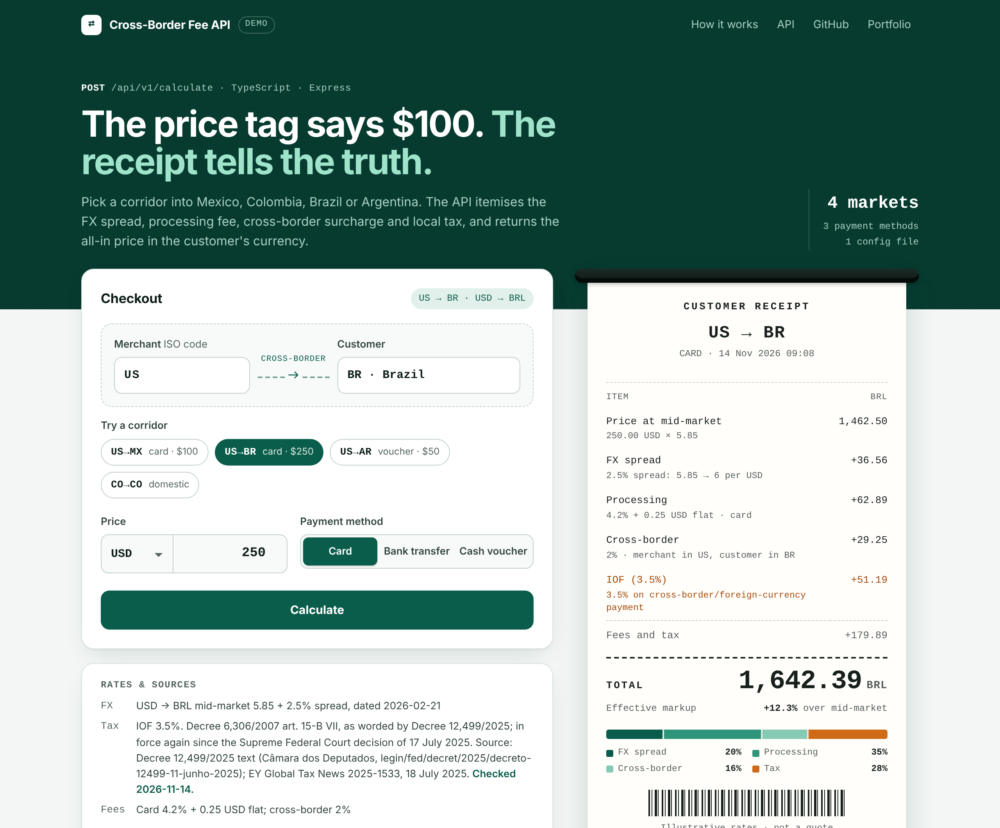
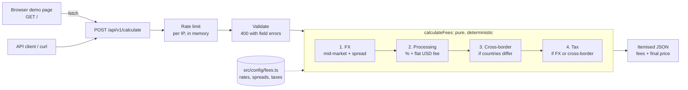

# Cross-Border Fee Calculation API

**Live demo: [cross-border-fee-api.vercel.app](https://cross-border-fee-api.vercel.app)** · by [Nityashree S](https://nityashree.in)

[](https://cross-border-fee-api.vercel.app)

A TypeScript/Express API that returns an **itemised estimate of the all-in price a customer pays** for a cross-border purchase into Mexico, Colombia, Brazil or Argentina: FX spread, processing fee, cross-border surcharge and tax, each as its own line. It is a proof of concept: the rates are illustrative constants (FX rates dated 2026-02-21) and two tax rules are out of date (see [Known Limitations](#known-limitations-checked-2026-11-13)).

## Why

A price of USD 100 can cost a customer in Argentina far more than one in Colombia, and the difference is spread over four separate charges. Showing each charge, with its rate and the rule that triggered it, makes the price explainable to a customer, a merchant and a support team. The design goal was transparency: one config file holds every number, and a pure function applies them in a fixed order.

## The demo

The live page is a form over the real API (the same `POST /api/v1/calculate` a client would call). Pick a scenario or enter your own; the page shows the final price, a breakdown bar, each fee line with its rule, and the matching `curl` command. Browsers get the page at `/`; API clients that ask for JSON at `/` still get the JSON index.

The public deployment is rate limited (30 calculations a minute per client IP, per running instance) and needs no keys or secrets.

## Quick Start

```bash
npm install
npm run dev        # http://localhost:3000 (demo page) with auto-reload
npm test           # 40 Jest tests

# or build and run
npm run build && npm start
```

## Architecture



```
api/index.ts              # Vercel entry: exports the Express app
src/
├── config/fees.ts        # All fee rates, FX rates, tax rules (no magic numbers)
├── config/countries.ts   # ISO 3166-1 alpha-2 codes for merchant_country
├── engine/
│   ├── calculator.ts     # Core fee calculation: pure, deterministic function
│   └── fx.ts             # FX conversion with spread + in-memory cache
├── middleware/
│   ├── validate.ts       # Request validation with detailed error messages
│   ├── rateLimit.ts      # Fixed-window limit per client IP
│   └── errorHandler.ts   # Global error handler (no internals in 500s)
├── routes/
│   ├── calculate.ts      # POST /api/v1/calculate
│   ├── meta.ts           # GET /api/v1/config (markets, rates and their dates)
│   └── health.ts         # GET /health
├── ui/page.ts            # The one-page demo UI served at GET /
├── types/index.ts        # All TypeScript interfaces
├── app.ts                # Express app setup
└── index.ts              # Local server entry point
```

**Design principles:**
- **Config-driven**: Every fee rate, FX spread, and tax rule lives in `src/config/fees.ts`. Zero magic numbers in business logic.
- **Pure engine**: `calculateFees()` is a stateless pure function, deterministic for identical inputs and easy to test.
- **Layered**: Config → Engine → API are cleanly separated. The engine has no knowledge of HTTP.

## API Documentation

### `POST /api/v1/calculate`

Calculate all-in customer price for a transaction.

**Request body:**

| Field              | Type   | Required | Values                                     |
|--------------------|--------|----------|--------------------------------------------|
| `original_amount`  | number | yes      | 0.01 to 1,000,000                          |
| `original_currency`| string | yes      | `USD`, or the customer's own currency (e.g. `MXN` for `MX`) |
| `customer_country` | string | yes      | `MX`, `CO`, `BR`, `AR`                     |
| `merchant_country` | string | yes      | Any ISO 3166-1 alpha-2 code (e.g., `US`, `MX`); case-insensitive |
| `payment_method`   | string | yes      | `card`, `bank_transfer`, `cash_voucher`     |

**Response:**

| Field                  | Type       | Description                                      |
|------------------------|------------|--------------------------------------------------|
| `original_amount`      | number     | Input amount                                     |
| `original_currency`    | string     | Input currency                                   |
| `settlement_currency`  | string     | Customer's local currency                        |
| `settlement_amount`    | number     | Amount at mid-market rate (before fees)           |
| `fx_rate`              | number\|null | Effective FX rate applied (null if same currency)|
| `fx_spread_pct`        | number\|null | FX spread percentage                            |
| `fees`                 | array      | Detailed fee line items                          |
| `total_fees`           | number     | Sum of all fees in settlement currency            |
| `total_fees_pct`       | number     | Total fees as fraction of settlement amount       |
| `final_customer_price` | number     | What the customer actually pays                  |
| `final_currency`       | string     | Currency of final price                          |

Each item in `fees` has: `name`, `rate`, `amount`, `currency`, `description`.

### `GET /api/v1/config`

The configured markets (currency, tax, cross-border and payment-method fees), the FX rates with their `updated_at` dates, and notes on what is out of date. The demo page builds its form from this.

### `GET /health`

Returns `{"status": "ok", "timestamp": "..."}`.

---

## Example API Calls

### 1. Cross-border card payment: US merchant → Mexican customer, $100 USD

```bash
curl -X POST http://localhost:3000/api/v1/calculate \
  -H "Content-Type: application/json" \
  -d '{
    "original_amount": 100,
    "original_currency": "USD",
    "customer_country": "MX",
    "merchant_country": "US",
    "payment_method": "card"
  }'
```

**Response:** Final price **MXN 2,118.03** (23.5% total fees on $100 USD)
- FX spread (2.5%): MXN 42.88
- Card processing (3.5% + $0.30): MXN 65.17
- Cross-border (1.2%): MXN 20.58
- IVA tax (16%): MXN 274.40

### 2. Domestic transaction with FX: MX merchant → MX customer, $100 USD, bank transfer

```bash
curl -X POST http://localhost:3000/api/v1/calculate \
  -H "Content-Type: application/json" \
  -d '{
    "original_amount": 100,
    "original_currency": "USD",
    "customer_country": "MX",
    "merchant_country": "MX",
    "payment_method": "bank_transfer"
  }'
```

**Response:** Final price **MXN 2,063.15** (20.3% total fees)
- No cross-border fee (domestic)
- Still has FX spread and tax (foreign currency transaction)

### 3. Cross-border card payment: US merchant → Brazilian customer, $250 USD

```bash
curl -X POST http://localhost:3000/api/v1/calculate \
  -H "Content-Type: application/json" \
  -d '{
    "original_amount": 250,
    "original_currency": "USD",
    "customer_country": "BR",
    "merchant_country": "US",
    "payment_method": "card"
  }'
```

**Response:** Final price **BRL 1,686.26** (15.3% total fees)
- IOF tax at 6.5% (lower than MX IVA)
- Cross-border 2.0%

### 4. Cross-border cash voucher: US merchant → Argentine customer, $50 USD

```bash
curl -X POST http://localhost:3000/api/v1/calculate \
  -H "Content-Type: application/json" \
  -d '{
    "original_amount": 50,
    "original_currency": "USD",
    "customer_country": "AR",
    "merchant_country": "US",
    "payment_method": "cash_voucher"
  }'
```

**Response:** Final price **ARS 75,915** (44.6% total fees!)
- The 30% rule labelled PAIS is the dominant cost (the PAIS tax itself ended in December 2024; see Known Limitations)
- FX spread 5% (volatile currency)
- This illustrates why AR customers see massive markups

### 5. Fully domestic: CO merchant → CO customer, 500,000 COP, bank transfer

```bash
curl -X POST http://localhost:3000/api/v1/calculate \
  -H "Content-Type: application/json" \
  -d '{
    "original_amount": 500000,
    "original_currency": "COP",
    "customer_country": "CO",
    "merchant_country": "CO",
    "payment_method": "bank_transfer"
  }'
```

**Response:** Final price **COP 510,000** (2.0% total fees)
- Only payment processing fee (2%)
- No FX, no cross-border, no tax — cheapest scenario

### 6. Validation error

```bash
curl -X POST http://localhost:3000/api/v1/calculate \
  -H "Content-Type: application/json" \
  -d '{"original_amount": -50}'
```

**Response (400):**
```json
{
  "error": "Validation failed",
  "details": [
    {"field": "original_amount", "message": "original_amount must be a positive number"},
    {"field": "original_currency", "message": "original_currency is required"},
    ...
  ]
}
```

A price in a currency with no rate to the customer's currency (for example an MXN price for a customer in CO) is also a 400 on `original_currency`. Malformed JSON returns 400 `{"error": "Malformed JSON", ...}`. Unexpected server errors return 500 `{"error": "Internal server error"}`; the detail is logged, not sent to the client.

---

## Fee Logic & Assumptions

### Calculation Order

1. **FX Conversion** — Convert original amount to customer's local currency using mid-market rate + spread markup
2. **Payment Processing Fee** — Percentage + flat fee (flat fee converted to local currency)
3. **Cross-Border Fee** — Applied only when `customer_country ≠ merchant_country`
4. **Tax Withholding** — Applied when the transaction is cross-border OR involves foreign currency

All percentage fees are calculated on the **mid-market equivalent** (not the spread-inflated amount), preventing fee-on-fee compounding.

### Country Assumptions

| Country | Currency | Tax | Cross-Border | Notes |
|---------|----------|-----|--------------|-------|
| MX | MXN | 16% IVA | 1.2% | Standard Mexican digital services tax |
| CO | COP | 19% IVA | 1.5% | Colombian VAT on cross-border services |
| BR | BRL | 6.5% IOF | 2.0% | IOF tax on foreign currency card transactions (out of date: 3.5% since 23 May 2025) |
| AR | ARS | 30% PAIS | 2.5% | Labelled PAIS tax (out of date: PAIS ended December 2024); highly volatile FX |

### FX Rates

Mocked mid-market rates, dated 2026-02-21 in `src/config/fees.ts` and not refreshed since. Spreads:
- MXN: 2.5% (stable corridor)
- COP: 3.0%
- BRL: 2.5%
- ARS: 5.0% (reflects blue-dollar volatility)

In production, these would come from a live FX API with a Redis-backed cache.

### Trade-offs

| Decision | Why |
|----------|-----|
| In-memory config vs DB | Speed and simplicity for POC; production would use a config service |
| Mocked FX rates | Avoids external API dependency; structure supports real integration |
| Fees on mid-market base | Prevents compounding — more transparent to customers |
| Tax on full base amount | Simplified; real tax rules vary by transaction type |
| No authentication | Out of scope for POC; production would use API keys |
| No persistence | Stateless by design; every call is self-contained |

## Known Limitations (checked 2026-11-13)

Fixed on 2026-11-12: `merchant_country` must be a real ISO 3166-1 alpha-2 code (it accepted any 2 characters, such as `zz`), and `original_amount` must be at least 0.01 (0.001 USD was accepted and charged a 0.30 USD flat fee, about 300% of the price).

Fixed on 2026-11-13: the fee lines always add up to `total_fees`, and `settlement_amount + total_fees` is always `final_customer_price`. Totals were summed from unrounded amounts, so about a third of quotes were a cent off (0.38 USD → MX by card listed 0.16 + 5.37 + 1.04 = 6.57 MXN of fees but a total of 6.58). Half-cent amounts now round up: the 2.5% FX spread on 1,715 MXN is 42.875 and showed as 42.87. The 5 scenarios now assert every fee line, the totals and the final price exactly (they only checked which fees appeared), so a changed rate fails a test.


- **Argentina "PAIS tax" is out of date.** Argentina's Impuesto PAIS ended in December 2024 (reported by EY Global Tax News, 7 January 2025). The 30% rate in `src/config/fees.ts` is labelled PAIS; a separate 30% income-tax withholding regime continued on some foreign-currency transactions, per the same report. The rule's name and scope need verifying before use.
- **Brazil IOF rate is out of date.** Brazil set IOF on international card payments at 3.5% from 23 May 2025 (Decree 12.466/2025). The config uses 6.5%.
- **Floating-point money.** Amounts are JavaScript numbers rounded to 2 decimals (half up) for every currency; production code should use integer minor units per currency, and ARS and COP are usually shown without cents.
- **Only USD → local FX rates exist**, and they are mocked constants dated 2026-02-21.
- **The rate limit is per instance.** Counts live in memory, so each serverless instance counts on its own. It stops one client from hammering one instance; a global quota would need a shared store such as Redis.
- **No authentication.** Fine for a public demo of mocked rates; a real service would use API keys.

---

## Testing

```bash
npm test
```

Runs 40 tests across three suites (94.3% line coverage with `npx jest --coverage --forceExit`, measured 2026-11-13):
- **Engine tests** (12): All 5 scenarios with every fee amount and the final price checked exactly, the USD flat fee converted for local-currency prices, fee lines adding up to the totals across about 14,000 quotes, half-cent rounding, determinism check, error handling
- **API tests** (20): HTTP integration, validation errors (including malformed JSON, unsupported currency pairs, merchant countries that are not ISO codes and amounts below 0.01 as 400), server errors as 500 without internal detail, health check
- **Demo tests** (8): the HTML page for browsers and JSON for API clients at `/`, the config endpoint, rate-limit headers, 429 after the limit, the window reset, and per-client counting on Vercel

## Deployment

Deployed on Vercel's free tier from this repository: every push to `main` deploys. `vercel.json` sends every path to the Express app in `api/index.ts`. Optional environment variable: `RATE_LIMIT_PER_MINUTE` (default 30).

---

Built by [Nityashree S](https://nityashree.in) · [GitHub](https://github.com/Nityaa08)
